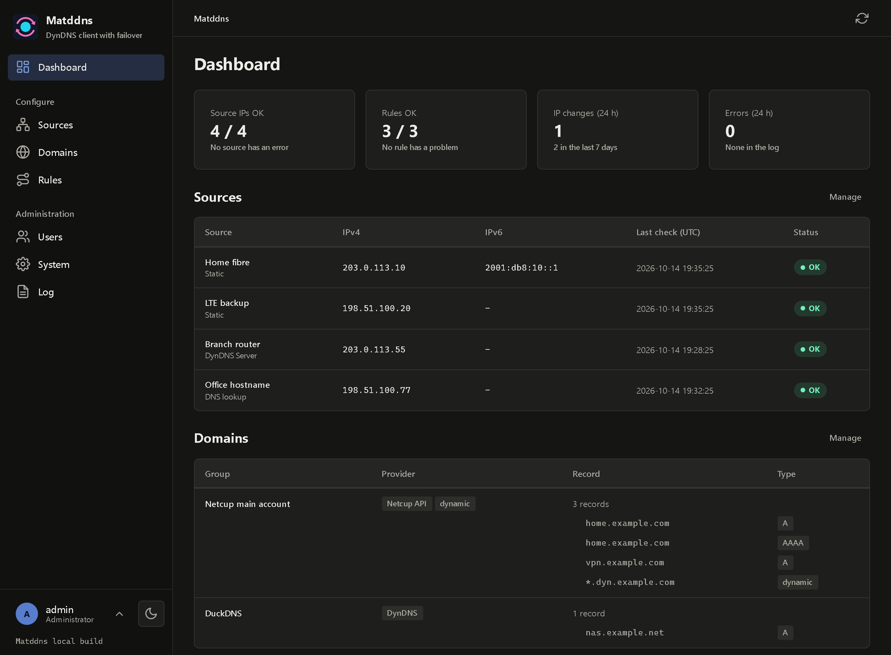
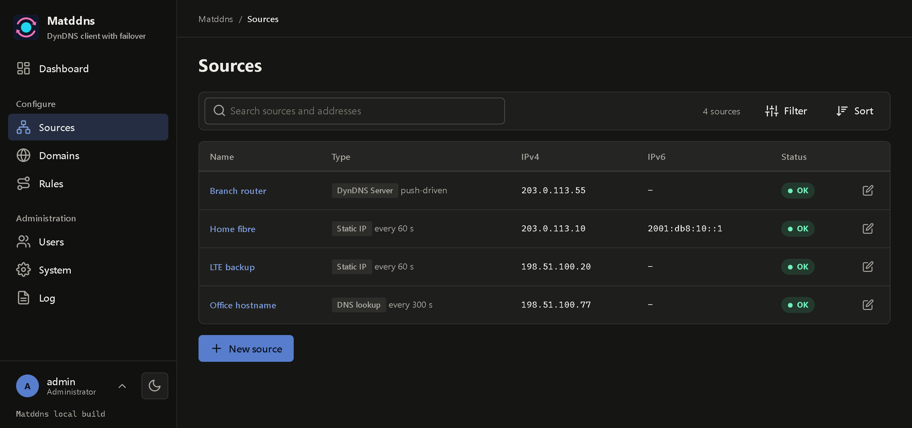
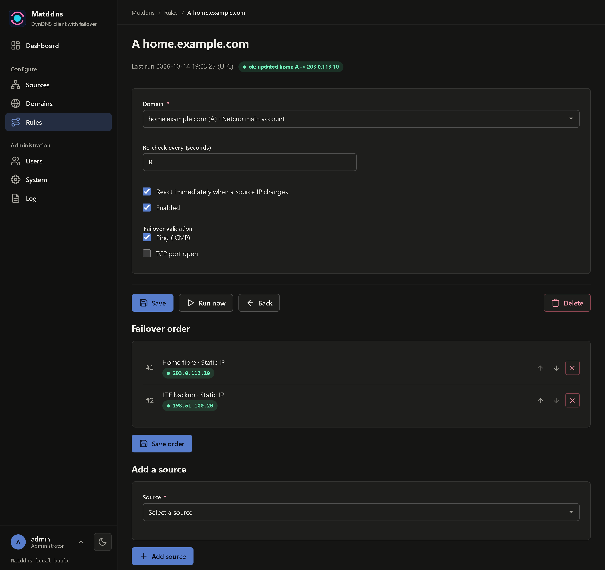
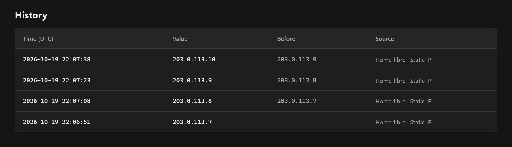
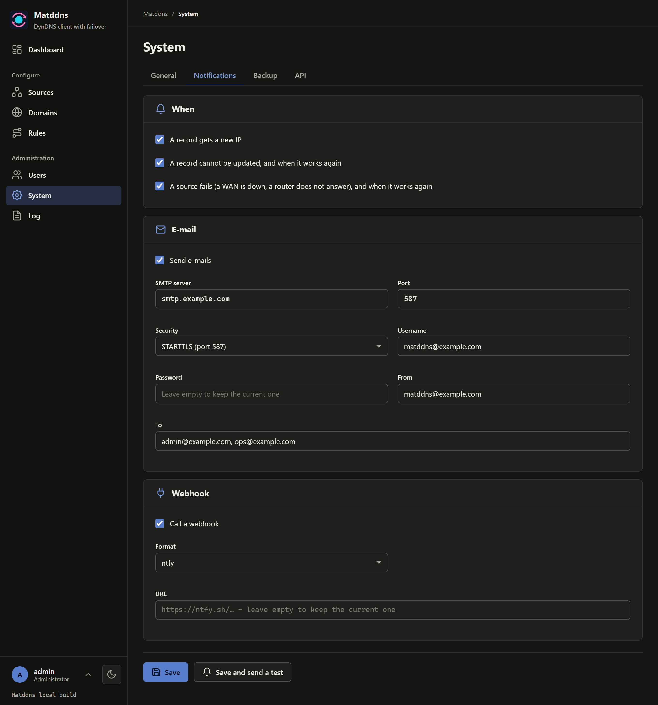
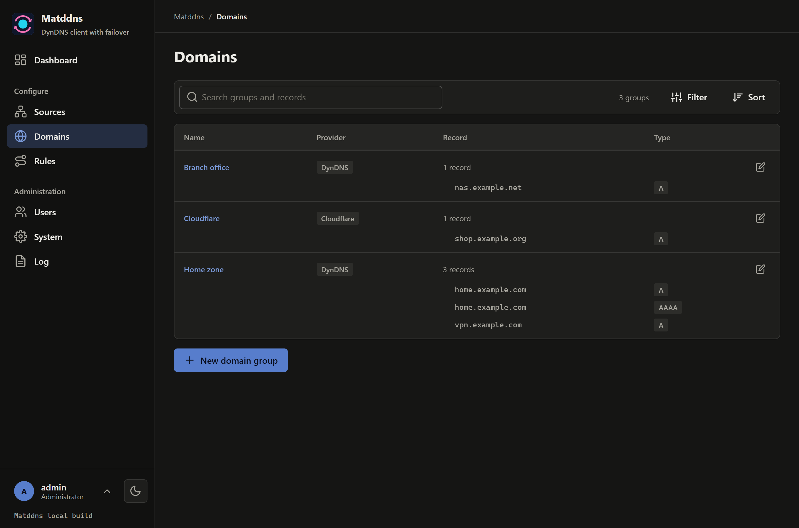
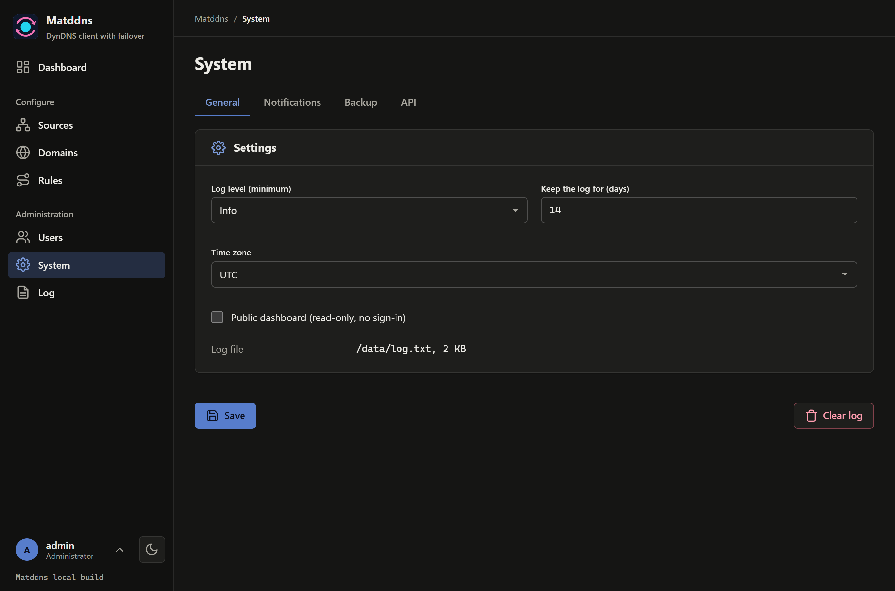
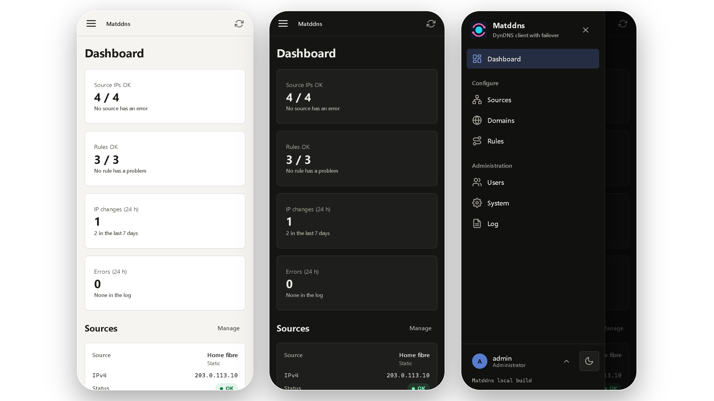

<div align="center">


# Matddns

**A universal DynDNS updater with a web UI.**

Pull an IP from many sources – your public IP, UniFi WANs, a FRITZ!Box, a DNS name,
a static value or a value pushed in – and keep your DNS records in sync, with failover
to the first reachable source. One container, no cloud, no third-party services.

[](https://github.com/Real-TTX/Matddns/actions/workflows/docker-publish.yml)
[](https://github.com/Real-TTX/Matddns/pkgs/container/matddns)


</div>



---

## What this is about

The DynDNS client on a router updates one provider with one IP. Matddns sits in the middle:
several IP **sources**, several DNS **targets**, and **failover rules** that move a record onto
the next reachable source when a WAN goes down. Everything is configured in a web UI, with a
dashboard and a monitoring API on top – and it can also *receive* updates, so a router can push
its IP into Matddns just like it would to any DynDNS provider.

## At a glance

**Sources – where an IP comes from**
- The container's own **public IPv4/IPv6**
- **UniFi** UDM/UGW WANs read locally from the controller (incl. LTE failover), or from the
  **UniFi Site Manager cloud** (one key, pick the gateways)
- A **FRITZ!Box** over TR-064 (locally via `fritz.box`, or remotely via MyFRITZ!)
- A **DNS lookup** of any hostname → its A/AAAA
- A **static** value you type in
- A **pushed-in** value (DynDNS server, see below)
- Another **Matddns peer** (pull over its JSON API)

**Targets – where an IP is written**
- The **Cloudflare**, **Netcup**, **Hetzner DNS** and **GoDaddy** APIs (record + zone,
  A/AAAA/CNAME, optional create-on-demand)
- Another **Matddns peer** (push over its JSON API)
- Generic **DynDNS update URLs** with presets for 29 providers (DuckDNS, No-IP, Dynu, Namecheap, OVH,
  DynDNS.org, Strato, deSEC, DynV6, …)

**Failover, dual-stack, operations**
- **Failover rules**: a record is bound to an ordered list of sources; the first reachable wins
- **Reachability validation**: a source counts only if its IP answers a **ping** or a **TCP-port** check
- **History and notifications**: every change of a record is kept (value, before, source); e-mail or a webhook (JSON, ntfy, Gotify)
  on a new IP, a failed update, a failing source and each recovery; failed updates are retried with a growing wait
- **Backup**: export and import of the whole configuration
- **Dual-stack**: every source carries an optional IPv4 and IPv6 (IPv6-only works too)
- **Multi-user login** with **rate-limited sign-in**, a per-install **time zone**, an adjustable
  **log level** with retention, and an optional **read-only public dashboard**
- **Installable web app (PWA)** for phone and desktop: light/dark/system theme, safe-area aware on
  iOS and Android, and an offline mode that shows the last known dashboard (see
  [Install as an app](#install-as-an-app-pwa))
- **Monitoring API** (`/api/health`, `/api/state`), an optional key-protected
  [management API](#management-api-for-mattiverse) to provision sources, domains and rules,
  and one **.NET 10 container** with a single `/data` volume; CI publishes the image to GHCR on every push

## Screenshots

### Sources – every WAN and its current IP



Each source keeps its current IPv4 and IPv6. UniFi WANs (and cloud gateways) appear
automatically, one row per WAN including LTE failover.

### Rules – failover in an order you choose



A rule links one DNS record to an ordered list of sources. The first reachable one wins;
ping/TCP validation and the check interval are set per rule.

### History – every IP a record had



Every change of a record is kept with the value before and the source it came from, on the rule page and as
*Recent IP changes* on the dashboard.

### Notifications – mail and webhooks



*System → Notifications* sends a message when a record gets a new IP, fails or works again, and when a source fails or
works again, by e-mail and/or a webhook (JSON, ntfy, Gotify). With MatSMTP the server fields are fixed (see [Notifications](#notifications)).

### Domains and the system settings

| Domains | System |
|---|---|
|  |  |

Domains group your records per provider zone; System holds the general settings and the API
docs, Users and Log sit next to it under Administration.

### On the phone



The same pages work at phone width: the menu becomes a drawer, wide tables keep their key
columns, and the theme follows the system unless you pick one in the menu.

## Quick start

Ready-made images are published to the GitHub Container Registry:

| Tag | Built from | Use it for |
|---|---|---|
| `ghcr.io/real-ttx/matddns:latest` | `main` | releases (amd64) |
| `ghcr.io/real-ttx/matddns:0.4.<n>` | `main` | pin a specific build (amd64) |
| `ghcr.io/real-ttx/matddns:latest-arm64` | `main` | releases on ARM64 (Raspberry Pi etc.) |
| `ghcr.io/real-ttx/matddns:0.4.<n>-arm64` | `main` | pin a specific ARM64 build |

### 1. Just run it

Copy this into `docker-compose.yml` and start it – nothing else needed:

```yaml
services:
  matddns:
    image: ghcr.io/real-ttx/matddns:latest
    container_name: matddns
    restart: unless-stopped
    ports:
      - "4060:8080"
    volumes:
      - ./data:/data
    environment:
      - TZ=Europe/Berlin
      # - MAT_API_KEY=                 # key of the platform API /api/* (Mattiverse sets it)
      # - MATIDENTITY_AUTHORITY=       # https://id.example.com: sign-in through MatIdentity
      # - MATIDENTITY_CLIENT_ID=matddns
      # - MATIDENTITY_CLIENT_SECRET=
      # - MATIDENTITY_INTERNAL_URL=    # http://matidentity:2300 inside Docker
      # Mail through MatSMTP (optional; Mattiverse sets them when MatSMTP is installed): all notification mail goes there and
      # the SMTP server fields of System -> Notifications are fixed
      # - MATSMTP_HOST=                # mattiverse-matsmtp-matsmtp
      # - MATSMTP_PORT=2025
      # - MATSMTP_USERNAME=matddns
      # - MATSMTP_PASSWORD=
      # - MATSMTP_FROM=                # matddns@example.com
      # - MATSMTP_TLS=none             # none, starttls or tls
    # lets the non-root user send ICMP for the "Ping" failover check
    sysctls:
      - net.ipv4.ping_group_range=0 2147483647
    healthcheck:
      test: ["CMD", "curl", "-fsS", "-o", "/dev/null", "http://localhost:8080/api/health"]
      interval: 30s
      timeout: 5s
      retries: 3
      start_period: 20s
```

```bash
docker compose up -d
```

Open **http://localhost:4060** and sign in with **`admin` / `admin`**. Change the password
under *Users* (or the user menu, *Change password*) before exposing Matddns beyond localhost. An update is just
`docker compose pull && docker compose up -d`; the `./data` folder keeps the config, log and
session keys.

Without Compose:

```bash
docker run -d --name matddns -p 4060:8080 -v "$PWD/data:/data" \
  --sysctl net.ipv4.ping_group_range="0 2147483647" \
  ghcr.io/real-ttx/matddns:latest
```

### 2. Set up sources, targets and rules

Everything is configured in the UI – there are no files to hand-edit:

1. **Sources** → add where an IP comes from (public IP, UniFi, FRITZ!Box, …). Network sources
   fill in their current IP within a few seconds.
2. **Domains** → add a provider account and the records to keep in sync (a full FQDN plus
   type A, AAAA or CNAME; for zone-based providers a record/subdomain + zone).
3. **Rules** → bind a record to an ordered list of sources and pick the triggers (on IP change
   and/or every N seconds) and optional ping/TCP validation.

### 3. From source

```bash
docker build -t matddns:local .
docker run -d --name matddns -p 4060:8080 -v "$PWD/data:/data" matddns:local
```

or run it directly with the .NET 10 SDK (`dotnet test Matddns.slnx` runs the tests):

```bash
dotnet run --project src
```

### Settings that matter

| Variable | Default | Meaning |
|---|---|---|
| `MATDDNS_ADMIN_PASSWORD` | `admin` | Initial password for `admin` on first start |
| `MATDDNS_API_KEY` | – | Key for the [management API](#management-api-for-mattiverse) (`X-Api-Key` header; config key `Matddns:ApiKey`). Unset = the API is disabled (`503`) |
| `MATDDNS_DATA` | `/data` | Data directory (config, log, keys) |
| `MATDDNS_FORWARDED_HEADERS` | – | Set to `true` behind a TLS reverse proxy to honor `X-Forwarded-Proto`/`-For` (secure cookie + real client IP) |
| `TZ` | – | Time zone for UI timestamps (the log and `/api/*` stay UTC) |
| `MAT_API_KEY` | `MATDDNS_API_KEY` | Key for the [platform API](#platform-api-mat-platform-contract) (`X-Api-Key` header). Unset = the engine key `MATDDNS_API_KEY` opens it too; neither = only a MatIdentity token opens it |
| `MATIDENTITY_AUTHORITY` | – | Address of MatIdentity (`https://id.example.com`). Set = [sign-in through MatIdentity](#sign-in-through-matidentity); unset = nothing changes |
| `MATIDENTITY_CLIENT_ID` | `matddns` | The client of Matddns in MatIdentity (also the audience of the tokens `/api` accepts) |
| `MATIDENTITY_CLIENT_SECRET` | – | Its secret |
| `MATIDENTITY_INTERNAL_URL` | – | Where Matddns reaches MatIdentity from inside Docker (`http://matidentity:2300`); the browser keeps using `MATIDENTITY_AUTHORITY` |
| `MATSMTP_HOST` | – | Address of [MatSMTP](#notifications) (inside Docker its container name). Set = all mail goes through MatSMTP and the SMTP server fields of *System → Notifications* are fixed |
| `MATSMTP_PORT` | `2025` | Its SMTP port |
| `MATSMTP_USERNAME` | – | The relay user of Matddns in MatSMTP (unset = no authentication) |
| `MATSMTP_PASSWORD` | – | Its password |
| `MATSMTP_FROM` | – | The sender of all mail (unset = the sender stored in Matddns) |
| `MATSMTP_TLS` | `none` | `none`, `starttls` or `tls` |

The in-container port is `8080` (mapped to `4060` above). The UI is English throughout.

**Lost the password?** There is no e-mail reset (no mail server involved). Stop the container, empty
the `users` list in `data/config.json`, and start it again: `admin` is re-created with
`MATDDNS_ADMIN_PASSWORD` (default `admin`). User names are free text, so an e-mail address works as one.

### The `/data` volume

```
/data
├─ config.json   sources, domains, rules, users, settings
├─ log.txt       application log (rotates to log.txt.1)
├─ history.jsonl the IP changes of every record (the newest 2,000)
└─ keys/         DataProtection keys (sessions survive restarts)
```

`config.json` is written atomically and fsync'd; if it ever becomes unreadable it is preserved
as `config.json.corrupt-<timestamp>` instead of being overwritten.

**Backup:** *System → Backup* downloads sources, domain groups, rules and settings as one JSON file, with the provider
credentials (keep it safe) and without the accounts. *Import* replaces all of them with such a file or an older `config.json`
(migrated on the way); the accounts stay and every rule is evaluated again.

## How it works

There are three building blocks.

### Sources (where an IP comes from)

| Kind | What it provides |
|------|------------------|
| Public IP | the container's own outbound IPv4/IPv6 |
| UniFi | one entry per WAN read from a local UDM/UGW (name, IPv4, global IPv6), incl. LTE failover |
| UniFi Cloud | gateways read from the UniFi Site Manager cloud API – one key, pick the gateways |
| FRITZ!Box | the WAN IPv4/IPv6 over TR-064 (locally via `fritz.box`, or via MyFRITZ!) |
| DNS lookup | resolves any hostname to its A/AAAA |
| Static IP | a fixed value you type in |
| DynDNS server | an external device pushes its IP to a token URL (see below) |
| Matddns peer | pulls the source entries of another Matddns instance over its JSON API |

Only globally routable addresses are kept – a WAN reporting a private/CGNAT or `0.0.0.0` value
is never pushed to DNS.

### Domains (where an IP is written)

| Kind | Target |
|------|--------|
| DynDNS | any provider via an update URL with `{ipv4}`, `{ipv6}`, `{hostname}` (or `{host}` and `{domain}` apart), `{user}`, `{password}` placeholders (empty ones are dropped, so one URL covers A and AAAA); presets prefill the URL |
| Netcup | the Netcup DNS API (record + zone) |
| Cloudflare | the Cloudflare API (API token with Zone.DNS edit) |
| Hetzner DNS | the DNS API of the Hetzner Cloud: a Cloud API token (read & write) of the project that holds the zone; tokens of the retired DNS Console do not work. A record set must hold exactly one record, the TTL is set to 60 s |
| GoDaddy | the GoDaddy DNS API (API key + secret) |
| Matddns peer | pushes the chosen IP to another Matddns instance over its JSON API |

Each entry is a single record: a full FQDN plus type A, AAAA or CNAME.

### Rules (the glue)

A rule links one record to an ordered list of source entries (the failover order). The record
type comes from the entry.

- Triggers are independent and can be combined: react on IP change (event-driven), and/or
  re-check every N seconds. A periodic re-check drives ping/TCP failover, because a source going
  down does not change its IP – so enabling a check also enforces a minimum interval.
- Validation: none, ping, or TCP port.
- History: every change of a record (value, the value before, the source) is kept in `history.jsonl`, apart from the log, so the
  log level, its retention or clearing it lose nothing. The rule page lists the changes of its record, the dashboard and the IP-change
  counts of `/api/health` and `/api/state` read them (an older install takes the updates of its log over once).

## Failover and validation

- **A / AAAA**: the first reachable source wins; its IP is written to the record.
- **CNAME**: the first reachable source wins; the target hostname configured per source is written.

A source counts as reachable only when its current IP passes the rule's validation:

| Validation | Needs |
|------------|-------|
| None | the source just has to have an IP |
| Ping | ICMP echo to the source IP (needs the `ping_group_range` sysctl shown above) |
| TCP port | a TCP connect to `IP:port` succeeds (no special privileges) |

A failed update is retried with a growing wait: 30 s after the first failure, then doubled each time up to 30 minutes (the rule page shows the next try). Saving the rule or its domain group, *Run now* and `POST /api/v1/run` start again at once or at the shortest wait.

## Notifications

*System → Notifications* tells you when a record gets a new IP, when it cannot be updated (once, at the first failure; Matddns keeps
trying with its back-off) and when it works again, and when a source entry fails (a WAN is down, a router or a peer does not answer;
once, at the first failure) and when it works again. Each kind can be switched off.

- **E-mail** over SMTP: server, port, STARTTLS / TLS / none, user, password, sender and one or more recipients.
- **Mail through MatSMTP:** when the `MATSMTP_*` variables are set (Mattiverse does that when MatSMTP is installed), all mail goes through
  MatSMTP. The page then says where the mail goes and shows server, port, security, user and sender as fixed (the password never);
  nothing is saved for them, and what was stored before counts again when the variables are gone. On/off and the recipients stay editable.
- **Webhook**: `JSON` (`{"app":"matddns","event":"change|failure|recovery|source-failure|source-recovery|test","title","message","record","type","value","previous","source","time"}`),
  `ntfy` (plain text with a `Title` header to a topic URL) or `Gotify` (`{"title","message","priority"}` to `/message?token=…`).

*Save and send a test* checks the setup right away. The SMTP password and the webhook URL (it can carry a token) are never shown again
or written to the log; a failed delivery is logged as a warning and dropped.

## DynDNS server (incoming)

A DynDNS-server source lets a device report its IP to a token-protected URL (shown on the
source's page, with copy-ready FRITZ!Box and UniFi examples). Both URLs take separate
`ipv4`/`ipv6` parameters; send either or both, and the other family is left untouched. Tokens
are compared in constant time, and the endpoints are rate-limited.

A **dynamic receiver** (a dynamic rule binding a DynDNS-server source to a Netcup, Cloudflare, Hetzner or GoDaddy zone) lets one
token manage many records under a namespace: the device sends `&hostname=<name>.<zone>` and that
record is created/updated on the fly (creating is opt-in per domain group: *Allow dynamic records*).

JSON API, for scripts and devices:

```http
GET /api/update?token=<token>&ipv4=<v4>&ipv6=<v6>
```

```jsonc
200 { "status": "ok", "changed": true, "ipv4": "…", "ipv6": "…", "time": "…" }
400 { "status": "no-ip" }
401 { "status": "unauthorized" }
```

Omit both IPs (or use the legacy auto-detecting `&ip=`) to fall back to the caller's IP.

dyndns2, for routers and FRITZ!Box (HTTP Basic auth, or `?token=` in the URL):

```http
GET /nic/update?ipv4=<v4>&ipv6=<v6>
```

This keeps the plain-text dyndns2 protocol routers expect: `good` / `nochg` / `badauth` /
`nohost`. Use `/api/update` everywhere else.

## Monitoring API

Unauthenticated JSON endpoints for monitoring software. They never expose passwords or API keys:

| Endpoint | Purpose |
|----------|---------|
| `GET /healthz` | liveness; returns `ok` while the app runs |
| `GET /api/health` | health summary: `status` (`ok` / `degraded` / `down`) plus source/rule counts; HTTP 200 for ok and degraded, 503 for down. `?strict=1`: 503 unless ok |
| `GET /api/state` | full state: per-source IPs, per-rule status, recent IP changes |
| `GET /api/source?token=` | peer pull: this instance's source entries (IPs only) for a valid token |

```bash
curl -f http://localhost:4060/api/health?strict=1   # point a monitor here and alert on a non-200 status
```

Both `/api/health` and `/api/state` are also endpoints of the [platform contract](#platform-api-mat-platform-contract). They stay
compatible with what monitors read before:

- **`/api/health`** is one answer for everybody: the contract's fields (`status`, `app`, `version`, `time`, `checks`) **plus every
  old field** (`sources`, `rules`, `ipChanges`, with the same names and values). `status` is `ok` or `degraded` exactly as before
  (degraded = a source entry or a record fails) and `down` when `config.json` cannot be read. **One change:** a degraded Matddns now
  answers **HTTP 200** (it used to be 503), because the contract's Docker `HEALTHCHECK` uses this address and a degraded app must not
  count as unhealthy. A monitor that alerts on degraded either reads `status` or calls **`/api/health?strict=1`** (503 unless ok,
  the old behaviour).
- **`/api/state` without credentials** (no `X-Api-Key`, no `Authorization: Bearer`) answers the old monitoring state, unchanged and
  anonymous as before. **With credentials** it is the contract's state (`{"time", "values"}` with the tiles below; a wrong key or
  token is `401`).

Keep Matddns on a trusted network or behind a reverse proxy; the optional public dashboard
exposes the same data as `/api/state`, nothing more.

## Management API (for Mattiverse)

Mattiverse installs Docker apps and gives each one a DNS record. For that it provisions Matddns through a small REST API
under **`/api/v1`**, which manages exactly what the UI manages: **sources**, **domains** (a provider account with its
records) and **rules**. Whatever the API writes is visible and editable in the UI.

**Enable it** by setting a key; without one the API answers `503` and cannot be reached at all:

```yaml
    environment:
      - MATDDNS_API_KEY=<a long random string>      # or the config key Matddns:ApiKey
```

Every request carries the key in the **`X-Api-Key`** header (compared in constant time). A missing or wrong key is `401`; after
10 of them within a minute the address gets `429` (with `Retry-After`, the same `{"error": …}` shape) for the rest of that minute,
here and on the key part of the platform API (`/api/state`, `/api/configure`, `/api/actions`). A valid key is never limited.
The login cookie is ignored, and the API paths are never redirected to the login page. Bodies and answers are JSON in the same
camelCase as `config.json`; errors are `{"error": "..."}` with `400` (invalid input), `404`, `409` (conflict) or `500`.

| Method and path | What it does |
|---|---|
| `GET /api/v1/status` | `{"ok":true,"app":"matddns","version":"<footer version>","apiVersion":1,"counts":{"sources":n,"domains":n,"rules":n}}` |
| `GET /api/v1/sources` · `POST /api/v1/sources` · `DELETE /api/v1/sources/{id}` | list · upsert · delete a source |
| `GET /api/v1/domains` · `POST /api/v1/domains` · `DELETE /api/v1/domains/{id}` | list · upsert · delete a domain group |
| `GET /api/v1/rules` · `POST /api/v1/rules` · `DELETE /api/v1/rules/{id}` | list · upsert · delete a rule |
| `POST /api/v1/run` | evaluate all rules now, like the periodic check; answers `{"ok":true}` |

`DELETE` answers `204` (`404` if the id does not exist). Ids are the 32-character hex ids of `config.json`; every answer carries them.

**Upserts are idempotent.** Repeating a `POST` with the same body changes nothing: no duplicate objects, ids stay stable.
The object is found by `id` (an unknown id is `404`), else by `name` (case-insensitive; `409` if several objects share the name) for
sources and domain groups, and by (`domainGroupId`, `domainEntryId`) for rules. A property that is left out of the body keeps its
stored value; send it to change it. Unknown properties are ignored, so an object read with `GET` can be sent back after editing.
`kind` is required when creating and cannot be changed afterwards.

**Sources** (`name`, `kind`, `intervalSeconds`, the kind's settings object, `managedBy`):

- `kind` is `PublicIp`, `Unifi`, `Static`, `Push`, `Dns`, `Fritzbox`, `UnifiCloud` or `Matddns`; the settings object is named after the kind
  (`unifi`, `static`, `push`, `dns`, `fritzbox`, `unifiCloud`, `matddns`), with the fields of the UI form
  (e.g. `{"static": {"ip": "203.0.113.7", "ipv6": ""}}`, `{"dns": {"hostname": "x.myfritz.net"}}`).
- A new `PublicIp`, `Static`, `Push`, `Dns` or `Fritzbox` source gets its single entry exactly like the UI creates it. For `Unifi`,
  `UnifiCloud` and `Matddns` the body may carry `entries: [{id?, label, interfaceName}]` (the complete list, matched by `id`, else by
  `interfaceName`); for the other kinds the engine owns the entry and the list is ignored.
- `intervalSeconds` is at least 15 (default 60; `Push` sources are never polled).
- Deleting a source (or an entry) drops it from the failover lists of the rules, as the UI does.
- Secrets (UniFi/FRITZ!Box password, UniFi Cloud key, push and peer tokens) are accepted but never returned; the answer says
  `"credentialsSet": true|false` instead.

**Domain groups** (`name`, `kind`, the kind's settings object, `entries`, `managedBy`):

- `kind` is `DynDns`, `Netcup`, `Cloudflare`, `Hetzner`, `GoDaddy` or `Matddns` (peer); the settings object is `dynDns`, `netcup`,
  `cloudflare`, `hetzner`, `goDaddy` or `matddns`, e.g. `{"cloudflare": {"apiToken": "...", "allowDynamic": true}}`.
- **Credentials are never returned** (Cloudflare/Hetzner token, Netcup customer number/key/password, GoDaddy key/secret, DynDNS
  URL/user/password, peer token); the answer has `"credentialsSet": true|false`. When a later upsert leaves the credentials out
  (or empty), the stored ones are kept.
- **`entries` is the complete list of the group's records:** `[{id?, hostname, type: "A"|"AAAA"|"CNAME", recordName?, domain?}]`.
  A record is matched by `id`, else by (`hostname`, `type`) and keeps its id; a record that is not in the list is removed; a new one
  is created. Leave `entries` out to leave the records alone (`[]` removes all of them).
- **Removing a record that a rule still uses is refused with `409`** (the message names the rule), and nothing is changed. The API
  never deletes a rule as a side effect: delete the rule first, then send the shorter list. (The UI, in contrast, deletes the rules
  together with the record.) Likewise `DELETE /domains/{id}` is `409` while rules use the group.
- Records follow the UI: `hostname` is a valid FQDN; Netcup, Cloudflare, Hetzner and GoDaddy are zone-based and also store the zone
  (`domain`) and record name (`recordName`), derived from the hostname unless you send them (send `domain` for zones such as
  `example.co.uk`); DynDNS and Matddns-peer groups store just the FQDN and cannot have `CNAME` records.

**Rules** (`enabled`, `onChange`, `intervalSeconds`, `validatePing`, `validateTcp`, `validationPort`, `domainGroupId`,
`domainEntryId`, `sourceEntryIdsInOrder`, `cnameTargets`, `managedBy`):

- The group and the record must exist, and every id in `sourceEntryIdsInOrder` must be a source entry (the failover order).
  `cnameTargets` has one target per source (needed for `CNAME` records); a source that stays in the list keeps its target.
- `intervalSeconds` is `0` (off) or at least 15, `validationPort` 1-65535. As in the UI, ping/TCP validation forces a re-check
  interval (60 s if none is set) and at least one trigger always stays on.
- The dynamic (pattern) rules of the UI are not part of the API.

**Effect.** Every write is validated completely first (an invalid request changes nothing), then saved atomically like a UI change.
The background updater reads the configuration every 15 seconds, so a change takes effect without a restart within that time;
`POST /api/v1/run` does it right now (it refreshes the sources and evaluates every enabled rule, ignoring the error back-off; a
record whose value did not change is not written again).

**`managedBy`.** Sources, domain groups and rules take an optional string `managedBy` (Mattiverse sends `"mattiverse"`). It is stored
in `config.json`, returned by the API (`null` when unset; `""` clears it) and shown in the lists and on the edit pages as a
**Managed by Mattiverse** badge ("Created by Mattiverse. Manual changes may be overwritten."). Editing such an object in the UI keeps
the field. It is optional, so older `config.json` files load unchanged and need no schema migration.

### Example: one app, from nothing to a DNS record

Create the source of the IP, a Cloudflare group with two records and a rule per record (`jq` only picks the ids out of the answers):

```bash
API=http://localhost:4060/api/v1
KEY=<the value of MATDDNS_API_KEY>
api() { curl -fsS -H "X-Api-Key: $KEY" -H 'Content-Type: application/json' "$@"; }

# 1. where the IP comes from: the container's own public IP
SRC=$(api -X POST $API/sources -d '{"name":"Public IP","kind":"PublicIp","managedBy":"mattiverse"}')
SRC_ENTRY=$(echo "$SRC" | jq -r '.entries[0].id')

# 2. a Cloudflare account with two records
DOM=$(api -X POST $API/domains -d '{
  "name": "Cloudflare", "kind": "Cloudflare", "managedBy": "mattiverse",
  "cloudflare": { "apiToken": "<Cloudflare token with Zone.DNS edit>", "allowDynamic": true },
  "entries": [
    { "hostname": "nextcloud.example.com", "type": "A" },
    { "hostname": "paperless.example.com", "type": "A" }
  ]
}')
DOM_ID=$(echo "$DOM" | jq -r '.id')

# 3. a rule per record: follow the public IP
for ENTRY in $(echo "$DOM" | jq -r '.entries[].id'); do
  api -X POST $API/rules -d "{
    \"domainGroupId\": \"$DOM_ID\", \"domainEntryId\": \"$ENTRY\",
    \"sourceEntryIdsInOrder\": [\"$SRC_ENTRY\"], \"managedBy\": \"mattiverse\"
  }"
done

# 4. write the records now instead of within 15 seconds
api -X POST $API/run
```

Running the same calls again changes nothing. To remove one host, delete its rule, then send the group with the shorter list
(the other record keeps its id and its rule):

```bash
api -X DELETE $API/rules/<id of the paperless rule>
api -X POST $API/domains -d '{"name":"Cloudflare","entries":[{"hostname":"nextcloud.example.com","type":"A"}]}'
```

`scripts/api-test.sh <base-url> <api-key>` runs this whole flow plus the validation and conflict cases with plain `curl`, against
a throw-away instance, and removes what it created (without a key it just checks that the API answers `503`):

```bash
docker run -d --name matddns-test -p 18702:8080 -e MATDDNS_API_KEY=testkey matddns:local
scripts/api-test.sh http://localhost:18702 testkey
```

## Platform API (Mat platform contract)

Matddns speaks the platform contract of the Mat apps (MatDesign `docs/PLATFORM.md`, shared code MatPlatform in `src/MatPlatform`,
a copy that is never edited here), so Mattiverse or any other app can show it, watch it, set it up and act on it without
knowing it beforehand. It lives next to the engine API (`/api/v1`) and the peer endpoints, which are unchanged.

| Endpoint | Purpose | Access |
|---|---|---|
| `GET /api` | the definition: who the app is (`matddns`, accent `#204db6`), its pages, tiles, settings and actions | anonymous |
| `GET /api/health` | `ok` / `degraded` / `down` with the checks `config`, `sources`, `rules` (plus the old monitoring fields, see above) | anonymous |
| `GET /api/state`, `GET /api/state/{key}` | the values of the tiles | key or token |
| `GET /api/configure`, `PUT /api/configure` | the general and the notification settings | key or token |
| `POST /api/actions/{id}` | run an action | key or token |

The key is `X-Api-Key: <MAT_API_KEY>` (without `MAT_API_KEY` the engine key `MATDDNS_API_KEY`); with MatIdentity also
`Authorization: Bearer <token>` for the audience `matddns`. Texts follow `Accept-Language` (`de`, `en`).

- **Tiles:** current IPv4 and IPv6 (of the source most records are written from), the active source, records in failover (written
  from a source other than their first choice), DNS records and how many are in sync (enabled rules whose last write succeeded),
  the last update (the last successful write) and the last error (an error in the log within 24 hours).
- **Settings:** time zone, the dashboard without sign-in, the minimum log level and how long the log is kept (the general settings
  of *System*), and the notifications (when, e-mail, webhook; the SMTP password and the webhook URL as secrets, never sent back): the
  same values in `config.json`. A change is written to the log with who made it. With MatSMTP the mail server fields are `fixed`
  (a change is `400`).
- **Actions:** *Update now* (`runNow`: one pass over all sources and rules, like `POST /api/v1/run`; started and answered right away),
  and links to Matddns, the sources, the log, the system settings and the notifications.
- Matddns has no roles (every account may do everything), so the definition names none.

## Sign-in through MatIdentity

Optional, on only when `MATIDENTITY_AUTHORITY` is set; without it Matddns signs in exactly as before.

- A visit to the sign-in page goes straight to MatIdentity (OpenID Connect, authorization code with PKCE) and comes back signed in.
  The local form stays at **`/Login?local=1`** (the way in when MatIdentity is down). In MatIdentity, the client of Matddns needs
  the redirect address **`/signin-oidc`** and the signed-out address **`/signout-callback-oidc`**.
- The first sign-in of a person creates an account (named after `preferred_username`, else the e-mail address) without a password,
  linked by the claim `sub`. An **existing account is never linked by its name alone**: when its name equals the person's user name or
  e-mail address, Matddns asks for that account's password once (`/Login?local=1&link=1`, ten minutes) and links it only when exactly
  that account signs in; another account links nothing, *Cancel* drops it. Several matches, or a match linked to another person, are refused.
- The sign-out ends the session at MatIdentity too.
- The peer endpoints (`/api/update`, `/api/source`, `/nic/update`, `/update`) keep their tokens and the engine API its key;
  MatIdentity changes none of them.

## Install as an app (PWA)

Matddns is an installable web app. Installing needs **HTTPS** (or `localhost`) – put it behind a
TLS reverse proxy and set `MATDDNS_FORWARDED_HEADERS=true`.

| Platform | How |
|---|---|
| Android / Chrome, desktop Chrome / Edge | the **Install app** button in the menu (or the browser's install icon) |
| iOS / Safari | **Share → Add to Home Screen** (iOS has no install button for web apps) |

**Offline and reconnecting**

- Offline, the **dashboard** shows the last copy that was loaded, marked as "last known state".
  Every other page shows an offline screen that retries by itself and opens the page you wanted as
  soon as the server answers.
- Forms are **not** sent while offline (nothing is queued or replayed): the page stays as it is so
  nothing you typed is lost, and a banner says so.
- When the connection returns, read-only pages reload so no stale data stays on screen. The dashboard
  also refreshes itself every 30 s while it is visible, and when the app comes back to the foreground.
- Only the dashboard copy and the app files (styles, scripts, icons) are kept on the device. **Signing
  out deletes the dashboard copy.** Pages with tokens or credentials are never stored.
- A short "loading" bar and a busy button show that a request is running, so a slow DynDNS call can't be
  sent twice by a second tap.

**On phones:** pinch zoom stays available, form fields are 16 px so iOS doesn't zoom when one gets
focus, and the layout respects the notch and the home indicator. The status bar follows the chosen
accent (`theme-color`); on iOS the installed app keeps the standard status bar, so it stays readable in light and dark.

## How it is built

- **.NET 10 / ASP.NET Core Razor Pages**, cookie auth (the management API uses a key instead), a hosted background updater service
- UI on **MatUi**, the toolkit of the Mat design system (MatDesign): plain CSS and JavaScript, no
  build step, one inline SVG icon sprite, light/dark/system theme. The toolkit files in
  `src/wwwroot/matui` are a copy, not a link, so the app also works offline and as an installed app;
  `scripts/update-matui.ps1` fetches a newer release from a running MatDesign. The few styles only
  Matddns needs are in `src/wwwroot/css/matddns.css` (prefix `md-`); the service worker (`sw.js`) is
  versioned with the build
- `System.Text.Json` config in `/data/config.json` (atomic + fsync'd, schema-migrated on load);
  DataProtection keys in `/data/keys`
- Passwords hashed with **PBKDF2-SHA256** (600,000 iterations; older hashes are upgraded on the next
  login, minimum length 8). Changing a password or deleting a user ends that account's sessions.
- Per-IP **rate limiting** on the login page, the push endpoints, the monitoring API and wrong keys on `/api/v1` and `/api/*`; request URLs
  (which carry tokens) are kept out of the application log
- Docker (`mcr.microsoft.com/dotnet/aspnet:10.0`, non-root, `tzdata` for time zones, `HEALTHCHECK` on `/api/health`)
- Tests: `dotnet test Matddns.slnx` (xunit: unit tests plus the whole app in memory: the pages, the platform API, the old monitoring
  answers, the sign-in with and without MatIdentity, the engine API and the peer endpoints)
- GitHub Actions running the tests and publishing to GHCR on every push to `main`

## Versioning and schema

Release images carry a monotonic version (`0.4.<run_number>`) injected at build time; the footer
shows version, build and date. Local builds show `local · build local`.

`config.json` carries a `schemaVersion`. On startup, `ConfigService` runs every ordered migration
between the stored version and `CurrentSchemaVersion`, then stamps the new version and saves. A
fresh install starts at the current version; an older config is upgraded in place. To change the
data shape: raise `CurrentSchemaVersion`, append a `MigrateVXToVY` step (append-only), and raise
the release minor (`MAJOR_MINOR` in the CI workflow). A new *optional* property (such as `managedBy`)
needs no migration: a missing property loads as its default, an unknown one is ignored, and the
property is only written when it has a value.

## License

No license file is included yet. If you intend others to reuse this, add a `LICENSE` (for
example MIT) at the repo root.
